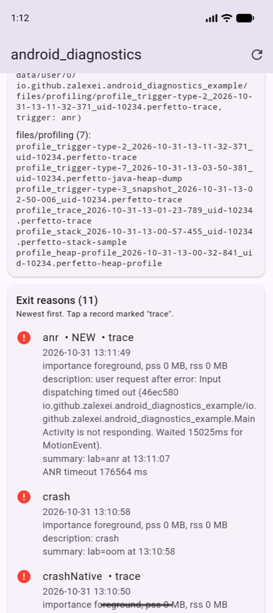
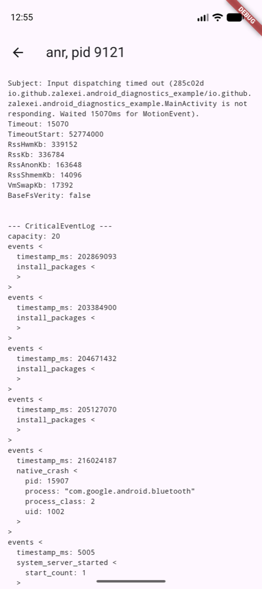
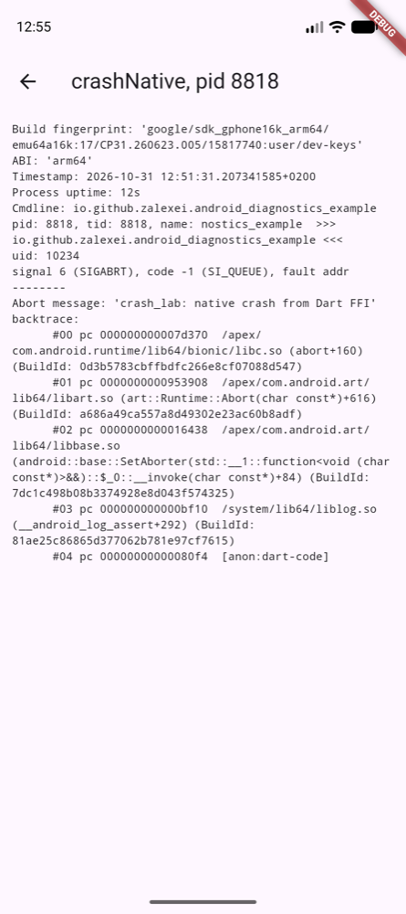
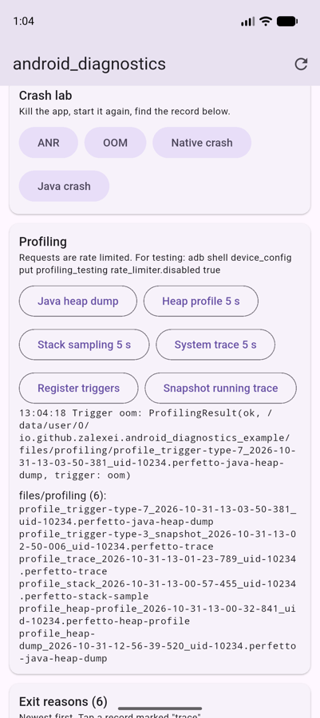

# app_diagnostics

[](https://pub.dev/packages/app_diagnostics)
[](https://github.com/Zalexei/app_diagnostics/actions/workflows/ci.yml)

Find out **why your Flutter app's process died** and **what it was doing**,
on Android and iOS, with the systems' own diagnostics:

- Android [`ApplicationExitInfo`](https://developer.android.com/reference/android/app/ApplicationExitInfo)
  (Android 11+): the reason for every recent process death (ANR, Java crash,
  native crash, low memory kill, force stop, package update, ...), memory at
  the time of death, the ANR stack dump and the native crash tombstone.
- Android [`ProfilingManager`](https://developer.android.com/reference/android/os/ProfilingManager)
  (Android 15+): Java heap dumps, heap profiles, CPU stack sampling and
  Perfetto system traces on request, plus system triggers (Android 16+) that
  capture a profile when an ANR, OOM or kill happens.
- iOS [MetricKit](https://developer.apple.com/documentation/metrickit)
  (iOS 14+, **beta**): crash, hang, CPU and disk write diagnostics with call stacks,
  slow launch diagnostics, and daily counts of every kind of app exit
  (memory limit, watchdog, crashes, background kills).

Crash reporters see exceptions while the process is alive. They miss what
kills it from the outside: the low memory killer, ANRs dismissed by the user,
"Force stop", the iOS watchdog, a native crash in a plugin. The next launch
can read all of that here.

`AndroidDiagnostics` and `IosDiagnostics` are safe to call on any OS version
and any platform: unsupported features return empty lists, `null`, `false` or
`ProfilingError.unsupported` instead of throwing. Like any plugin, they need
`WidgetsFlutterBinding.ensureInitialized()` before the first call when you
call them from `main`.

Android:

| Exit reasons after a restart | ANR trace | Native crash tombstone | Profiling |
|---|---|---|---|
|  |  |  |  |

## What works where

### Android

| Feature | API | Android | On older versions |
|---|---|---|---|
| `getExitReasons`, `takeNewExitReasons` | 30 | 11 | empty list |
| `setProcessStateSummary` (128 bytes, read back after death) | 30 | 11 | returns `false` |
| ANR stack dump: `getAnrTrace` | 30 | 11 | `null` |
| Native crash tombstone: `getNativeTombstone` | 31 | 12 | `null` |
| Reasons `freezer` / `packageStateChange`, `packageUpdated` | 33 / 34 | 13 / 14 | not reported by the system |
| `startProfiling`, `profile` (4 profile types), `profilingResults` | 35 | 15 | result `ProfilingError.unsupported`, empty stream |
| Triggers `appFullyDrawn`, `anr` | 36 | 16 | skipped by `addProfilingTriggers` |
| `requestRunningSystemTrace`; triggers `appRequestRunningTrace`, `killForceStop`, `killRecents`, `killTaskManager` | 36.1 | 16 (minor SDK 36.1) | `false` / skipped |
| `ExitInfo.anrInfo`; triggers `oom`, `anomaly`, `killExcessiveCpuUsage`, `coldStart`, `appCompat` | 37 | 17 | `null` / skipped |
| Reasons `memoryLimiter`, `anomaly` | 37.2 | 17 (minor SDK 37.2) | not reported by the system |

`AndroidDiagnostics.getSupport()` tells you what the current device offers.

### iOS

**Beta.** The iOS part builds and runs (checked on an iOS 27 simulator with
Xcode 27, CocoaPods and Swift Package Manager), but the simulator never
receives MetricKit reports, so the handling of real device reports has not
been verified yet. Reports from devices are welcome in the issue tracker.

| Feature | iOS | On older versions |
|---|---|---|
| `getDiagnosticReports`, `takeNewDiagnosticReports`: crashes, hangs, CPU and disk write exceptions with call stacks | 14 | empty list |
| `getMetricReports`, `takeNewMetricReports`: daily exit counts, peak memory | 14 | empty list |
| Diagnostics delivered on the next launch instead of once a day | 15 | daily delivery |
| `AppLaunchDiagnostic` (slow launches) | 16 | not reported |
| `MetricKitMetadata.pid`, `CrashDiagnostic.exceptionReason` (uncaught Objective-C exceptions), process state summary attached to diagnostics | 17 | `null` |
| `MetricKitMetadata.bundleIdentifier` | 26 | `null` |

`IosDiagnostics.getSupport()` tells you what the current device offers.
MetricKit has no per-event exit records like Android and no on-demand
profiling: exits come as daily counts, and diagnostics carry call stacks
instead of ANR dumps or tombstones.

## Install

```yaml
dependencies:
  app_diagnostics: ^0.1.0
```

Requirements: Flutter 3.35+. Android: app `compileSdk` 35+ (the plugin uses
`androidx.core:core:1.15.0`), `minSdk` 24. iOS: deployment target 13+
(MetricKit reports from iOS 14); the plugin builds with CocoaPods and with
Swift Package Manager (on by default since Flutter 3.47 and tested there).
No permissions or Info.plist keys needed.
The iOS part ships a privacy manifest: it uses no required-reason APIs and
sends nothing anywhere; if you upload reports, declare crash data in your app's
privacy details.

## Android

### Report why the previous process died

`takeNewExitReasons()` returns each record once across launches (the marker
is persisted), so call it on startup and send the result wherever you
collect telemetry:

```dart
import 'package:app_diagnostics/app_diagnostics.dart';

Future<void> reportPreviousDeaths() async {
  for (final exit in await AndroidDiagnostics.takeNewExitReasons()) {
    if (!exit.isAppProblem) continue; // skip force stops, updates, ...
    analytics.log('process_exit', exit.toJson());
    // {reason: anr, importance: foreground, rssKb: 336784,
    //  description: user request after error: Input dispatching timed out ...,
    //  processStateSummary: screen=checkout, ...}
  }
}
```

`getExitReasons(maxNum: 20)` returns the whole history the system keeps
(a ring buffer of recent deaths, newest first) without touching the marker.

#### ANR stack dump and native crash tombstone

```dart
final exits = await AndroidDiagnostics.getExitReasons();
for (final exit in exits.where((e) => e.hasTrace)) {
  switch (exit.reason) {
    case ExitReason.anr:
      // Text dump of all threads; look for the "main" thread.
      final text = await AndroidDiagnostics.getAnrTrace(exit);
      upload('anr-${exit.pid}.txt', text);
    case ExitReason.crashNative:
      // Android 12+: the protobuf tombstone, decoded in Dart.
      final tombstone = await AndroidDiagnostics.getNativeTombstone(exit);
      print(tombstone?.signal?.name);   // SIGABRT
      print(tombstone?.abortMessage);   // the message passed to abort()
      print(tombstone?.toText());       // logcat-style report with backtrace
    default:
      break;
  }
}
```

`getTraceBytes(exit)` gives the raw bytes if you want to ship them as is.
Traces live in a system-wide circular buffer, so read them on the first
launch after the death. The system keeps no stack trace for Java crashes
(`ExitReason.crash`): use your crash reporter for those.

`NativeTombstone` decodes the build, process, signal, abort message, causes
and the backtrace of every thread
([tombstone.proto](https://android.googlesource.com/platform/system/core/+/refs/heads/main/debuggerd/proto/tombstone.proto)).
Frames carry `relPc` and `buildId`, ready for `ndk-stack` or `llvm-symbolizer`.

#### Leave a note for the next launch

Up to 128 bytes that survive the process death and come back in
`ExitInfo.processStateSummary`:

```dart
await AndroidDiagnostics.setProcessStateSummaryText('screen=checkout;exp=new_cart');
```

Keep it short and free of personal data. The system may throttle frequent
calls (the method then returns `false`).

### Profile on users' devices (Android 15+)

```dart
// One-shot heap dump.
final dump = await AndroidDiagnostics.profile(
  const ProfilingRequest.javaHeapDump(tag: 'big-list'),
);

// Continuous profile around the code you care about.
final session = AndroidDiagnostics.startProfiling(
  const ProfilingRequest.systemTrace(tag: 'checkout', duration: Duration(seconds: 30)),
);
await openCheckout();
await session.stop(); // end early; otherwise it stops after `duration`
final result = await session.result;

if (result.isSuccess) {
  upload(result.filePath!); // open in https://ui.perfetto.dev
} else {
  print(result.error); // rateLimitSystem, profilingInProgress, unsupported, ...
}
```

Request types: `javaHeapDump`, `heapProfile` (native or Java allocations),
`stackSampling`, `systemTrace` (with `BufferFillPolicy.ringBuffer` to keep the
end of a long window). All parameters are optional; the system clamps them to
its limits. Results are files in the app's `files/profiling` folder: upload
and delete them yourself (`listProfilingFiles()` lists them).

#### Triggers (Android 16+)

The system captures a profile when something happens, even if the process
dies:

```dart
final sub = AndroidDiagnostics.profilingResults.listen((result) {
  if (result.isSuccess && result.trigger != ProfilingTriggerType.none) {
    upload(result.filePath!);
  }
});

final registered = await AndroidDiagnostics.addProfilingTriggers(const [
  ProfilingTrigger(ProfilingTriggerType.anr, rateLimitingPeriodHours: 24),
  ProfilingTrigger(ProfilingTriggerType.oom), // Android 17+: Java heap dump on OutOfMemoryError
  ProfilingTrigger(ProfilingTriggerType.appRequestRunningTrace),
]);
// `registered` holds only the triggers this device supports.

// Later, when something looks slow (SDK 36.1+):
await AndroidDiagnostics.requestRunningSystemTrace(tag: 'slow-scroll');
```

Results of a trigger that fired while the process was dying (OOM, kills)
arrive in the **next** process, as soon as it listens to `profilingResults`.
Subscribe early (e.g. in `main`); delivered files stay in the app's
`files/profiling` folder, so `listProfilingFiles()` also finds those of an
earlier launch.

The OOM trigger needs any custom `Thread.UncaughtExceptionHandler` to call
through to the default one.

## iOS

### Report crashes and hangs

MetricKit hands each report over once, often before Dart runs. The plugin
subscribes when the app starts and keeps reports on disk (the latest 50
diagnostic and 30 daily metric reports). `takeNew...` returns each report
once, so store or upload it before relying on it; `get...` returns all kept
reports, and `report.id` identifies a report across calls.

```dart
Future<void> reportIosDiagnostics() async {
  for (final report in await IosDiagnostics.takeNewDiagnosticReports()) {
    for (final d in report.diagnostics) {
      analytics.log('ios_diagnostic', {
        'title': d.title, // crash EXC_BAD_ACCESS (SIGSEGV), hang 4.3 s, ...
        'appVersion': d.metadata.appVersion,
        'summary': d.processStateSummaryText,
      });
    }
    upload('metrickit-${report.end.millisecondsSinceEpoch}.json', report.rawJson);
  }
}

// Listen first: the stream also fires right away when unread reports are
// waiting, and again whenever one arrives (on iOS 15+ diagnostics usually
// come a few seconds after launch).
IosDiagnostics.reportsArrived.listen((_) => reportIosDiagnostics());
```

Diagnostics are sealed: `CrashDiagnostic` (Mach exception, signal,
termination reason, Objective-C exception on iOS 17+), `HangDiagnostic`,
`CpuExceptionDiagnostic`, `DiskWriteExceptionDiagnostic` and
`AppLaunchDiagnostic`. Each has `metadata` (app and OS version, device, pid)
and a `callStackTree`:

```dart
final crash = report.crashes.first;
print(crash.callStackTree.toText());
// Thread 0 (attributed):
// 0   libsystem_kernel.dylib       0x00000001e2a4a1ec libsystem_kernel.dylib + 41452
// 1   App                          0x0000000104c1d000 App + 2214400
```

Frames are unsymbolicated, like in MetricKit: symbolicate them with the dSYM
whose UUID is `binaryUuid` (`atos -o <dSYM> -l <load address> <address>`);
Dart code is in the `App` binary. `report.rawJson` is MetricKit's own JSON,
byte for byte, ready to upload as is. For a thread stack the plugin takes the
root frame as frame 0 (the crash site), as MetricKit lists it.

### Daily exit counts

```dart
for (final day in await IosDiagnostics.takeNewMetricReports()) {
  final fg = day.foregroundExits;
  if (fg != null && fg.memoryResourceLimit > 0) {
    analytics.log('ios_oom', {'count': fg.memoryResourceLimit, 'day': '${day.end}'});
  }
  // fg.watchdog, fg.badAccess, day.backgroundExits?.memoryPressure, ...
}
```

`AppExitCounts.problems` sums the exits caused by the app (everything except
normal exits and background memory pressure).

### Process state summary on both platforms

```dart
Future<void> onScreen(String name) async {
  await AndroidDiagnostics.setProcessStateSummaryText('screen=$name');
  await IosDiagnostics.setProcessStateSummaryText('screen=$name');
}
```

Each call is a no-op on the other platform. On iOS the plugin keeps the
summary per pid and attaches it to diagnostics MetricKit reports for that pid
(iOS 17+, where MetricKit reports the pid).

## Testing locally

```bash
# Disable profiling rate limits on a test device
adb shell device_config put profiling_testing rate_limiter.disabled true
# Keep a background trace running and let triggers fire for your app
adb shell device_config put profiling_testing system_triggered_profiling.testing_package_name com.your.app
# What the system recorded about your app's deaths
adb shell dumpsys activity exit-info com.your.app
```

On iOS the simulator never receives MetricKit reports. On a device, run the
app from Xcode and choose Debug › Simulate MetricKit Payloads.

In your own tests, replace the platforms with fakes:

```dart
AndroidDiagnosticsPlatform.instance = MyFakeAndroidDiagnostics();
IosDiagnosticsPlatform.instance = MyFakeIosDiagnostics();
```

## Example app

[`example/`](example) has a crash lab on both platforms. Android: ANR, OOM,
native crash via `__android_log_assert`, Java crash; it shows the exit
records with their traces after a restart and runs every profiling type and
trigger. iOS: hang, native crash via `abort()`, uncaught Objective-C
exception, OOM (device only); it lists MetricKit reports with their call
stacks. `tool/crash_scenarios.sh SERIAL` drives the four Android crash
scenarios over adb.

Verified on an Android 17 (API 37.1) Pixel 9a emulator: all four deaths are
reported after restart with the process state summary; the ANR record carries
the main thread stack (`Thread.sleep` in the crash lab), the native crash
record decodes to `SIGABRT` with the abort message and backtrace; all four
profiling types return files; the running trace snapshot and the OOM heap
dump arrive through `profilingResults`, and so does the system trace of the
ANR trigger (the last two in the next process).

iOS was checked on an iOS 27.0 simulator (iPhone 18 Pro) with Xcode 27: the
plugin and the example build and run, the crash lab kills the app
(`abort()`: SIGABRT; the Objective-C exception: NSInvalidArgumentException),
summaries are stored per pid, reports in the store reach Dart with the `NEW`
marker kept across launches, and clearing works. The simulator delivers no
MetricKit payloads, so the conversion of real `MXDiagnosticPayload` and
`MXMetricPayload` objects has not run on a device yet; its JSON format is
covered by Dart tests.

## Notes

- `pssKb` / `rssKb` are the last sampled values, often 0 when the system did
  not sample the process before it died.
- `AnrInfo.timeout` is passed through from the platform as is; its meaning
  differs from the input dispatch timeout shown in `description`.
- iOS reports live in `Application Support/app_diagnostics`, excluded from
  backups. `IosDiagnostics.clearReports()` deletes them.
- Apple deprecates `MXMetricManager` and the `MX*` payload classes in the
  iOS 27.2 SDK in favor of the new `MetricManager` (iOS 27+). The plugin still
  uses the `MX*` API, which works on every iOS version from 14; with the 27.2
  SDK this means deprecation warnings, not errors.
- The Android part compiles against API 36 and reaches the newer API 36.1 / 37
  methods (`requestRunningSystemTrace`, `getAnrInfo`) through reflection,
  guarded by `Build.VERSION.SDK_INT_FULL`.
